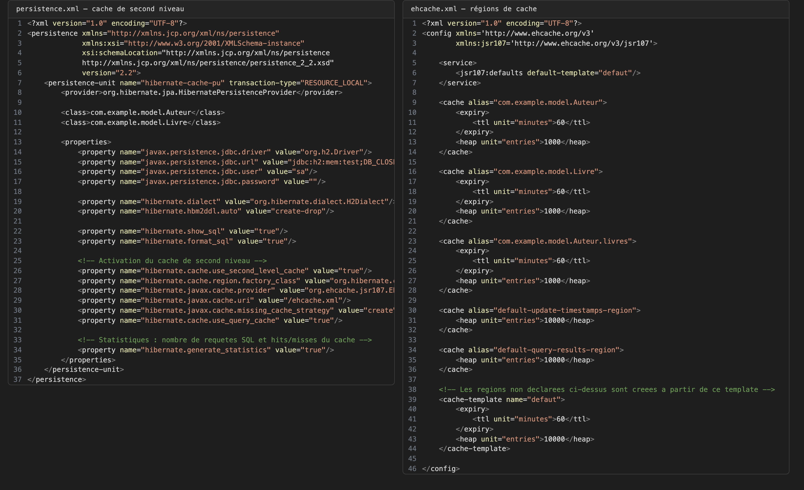
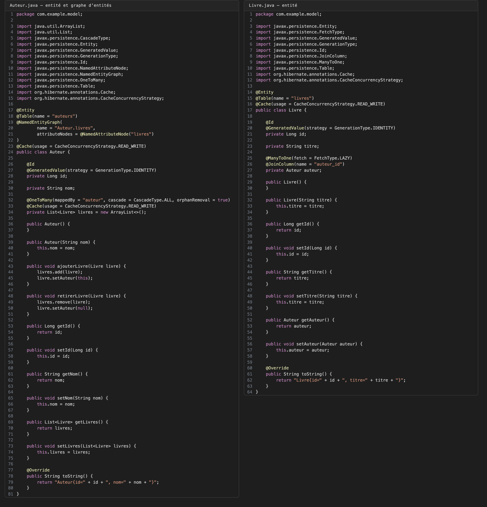
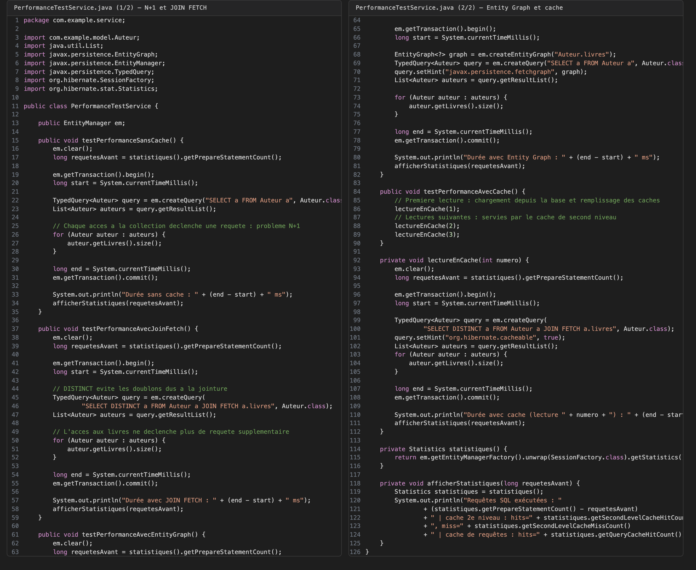
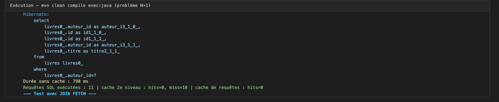
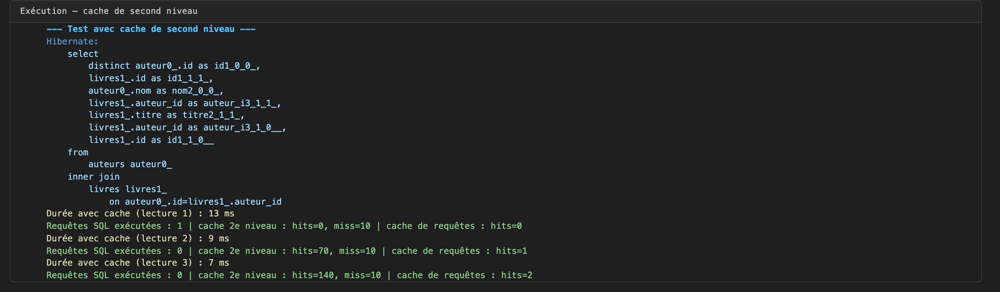

# TP 7 — Cache de second niveau, problème N+1 et optimisation des requêtes Hibernate

## 1. Configuration du cache : persistence.xml et ehcache.xml

## 2. Entités Auteur et Livre : @Cache et @NamedEntityGraph

## 3. Service de mesure : N+1, JOIN FETCH, Entity Graph, cache

## 4. Exécution — problème N+1 : 11 requêtes SQL sans cache

## 5. Exécution — cache de second niveau : 0 requête SQL en lecture 2 et 3

